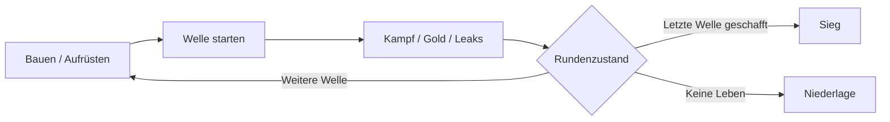

# TDG – Tower Defense Game

Ein geplantes, werbefreies Tower-Defense-Spiel für Desktop und Touch: taktische Tower-Kombinationen, freischaltbare Bausektoren und Bosskämpfe. Ohne Premiumwährung, gekaufte Kampfwerte oder Online-Zwang.

## Dokumentation und Stand

**Konzept vorhanden, Implementierung noch nicht begonnen.** Im Repository liegen Design und Entwicklungsplanung; noch kein Spielcode, Build oder ausführbarer Prototyp. Engine und konkrete Zielplattformen sind offen.

| Einstieg | Inhalt |
| --- | --- |
| [GDD v1.1](docs/TDG_GDD.txt) | Vollständige Regeln, Startwerte, Datenmodelle und Abnahmekriterien |
| [Entwicklungsleitfaden](docs/ENTWICKLUNG.md) | Prioritäten, Referenzkarte, Entscheidungen und offene Fragen |
| [Arbeitsregeln](AGENTS.md) | Dokumentationspflege für spätere Entwicklungsaufgaben |

Die Zahlen sind **ungetestete Design-Startwerte**, kein nachgewiesenes Balancing. Dokumentversionen sind keine Spiel-Releases.

## Ziele und Fortschritt

- **Ausgearbeitet:** Kernloop, fünf Tower mit fünf Stufen, Gegner, 30 Wellen, drei Bosse, Wirtschaft, Save-Konzept und Testkriterien.
- **Konkretisiert:** Flame mit Feuerkegel oder aufgeladenem Feuerball; konsistente Skalierung, Medaillen und Spawnregeln.
- **Als Nächstes:** Engine/Plattform entscheiden; Kernsimulation mit fünf Testwellen; anschließend eine spielbare Zehn-Wellen-Referenzkarte.
- **Langfristig:** zehn Karten, Normal/Hard/Expert, vollständige UI, Audio, Zugänglichkeit und persistenter Fortschritt.

## Bugs und offene Punkte

Noch keine Software-Bugs erfasst: Ohne Implementierung gibt es keine funktional geprüfte Version. Bekannte Designwidersprüche sind in GDD v1.1 korrigiert; offene Risiken betreffen vor allem Balancing, Kartenlayout, Zielhardware und den Nutzen beider Flame-Modi. Details stehen im Entwicklungsleitfaden.

Start-, Build- und Testanleitung folgen mit dem Projektgerüst. Fehlerberichte sollen Reproduktion, Soll-/Ist-Verhalten und Umgebung enthalten.

## Dokumentationspflege

Bei Änderungen GDD und Leitfaden konsistent halten; jede geänderte Dokumentation/README erhält einen kurzen Versionsverlauf in Stichworten. Details stehen im jeweiligen Abschnitt, nicht nochmals im Verlauf.

## Lizenz

[Unlicense](LICENSE).

## Versionsverlauf

- **1.1 · 2026-11-09:** GDD verlinkt; Projektstand korrigiert; Roadmap, Ablaufgrafik und Pflegekonvention.
- **1.0 · 2026-11-09:** Erste ausführliche Projektübersicht, Ziele und Einschränkungen.
