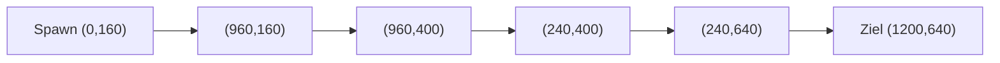

# TDG – Entwicklungsleitfaden

**Version 1.0 · 2026-11-09 · Status: Planung, noch kein Spielcode.**
Regeln und vollständige Tabellen: [GDD v1.1](TDG_GDD.txt).

## Prioritäten und Umfang

Das GDD bleibt das langfristige Zielbild. Zuerst Spaß und technische Verlässlichkeit
auf einer Karte prüfen, statt sofort zehn Karten und drei Schwierigkeiten zu bauen.

| Schritt | Umfang / Abnahme |
| --- | --- |
| Technologie | Engine, Sprache, Desktop-Ziel und Touch-Zielgeräte auswählen; Start-/Build-Anleitung ergänzen. |
| Kernsimulation (GDD 0.1) | Pfad, Gold, Leben, Archer und fünf Testwellen; komplette Mini-Runde ohne UI-Polish. |
| Vertikaler Prototyp | Eine Karte, Normal, zehn Wellen, Archer/Cannon/Frost, Stone Lord; Bau, Upgrade, Verkauf, Sieg/Niederlage. |
| Flame-Erprobung | Flame mit beiden Modi ergänzen; Trefferzahlen, DPS, Bedienung und Modusnutzen vergleichen. |
| Vollständiger Loop (GDD 0.2) | Arc, alle Gegner, 30 Wellen und drei Bosse auf derselben Karte. |
| Ausbau (GDD 0.3–1.0) | UI/Sektoren, Save/Resume, Audio/Zugänglichkeit, Balancing; danach weitere Karten und Schwierigkeiten. |

Sektoren sollen die prägende Entscheidung liefern: **mehr Feuerkraft jetzt oder
bessere Positionen später?** Zunächst verschiedene Reichweitenabdeckungen testen,
keine zusätzlichen Sektor-Kampfboni einführen.

## Referenzkarte: reproduzierbarer Startentwurf

Ungetestete Werte in World Units; keine Pixelbindung. Spielfeld 1200 × 800,
Ursprung links oben. Gegner-Radius zunächst 12 für normale Gegner, 20 für Bosse;
Tower-Radius 24, Mindestabstand der Mittelpunkte 48.

- Pfadmittelpunkte: `(0,160) → (960,160) → (960,400) → (240,400) → (240,640) → (1200,640)`.
- Pfadlänge: **3120 Units**, Wegbreite 40 (20 je Seite); Bau muss zusätzlich
  zum Tower-Radius Abstand halten: Towerzentrum mindestens 44 vom Pfadsegment.
- Bauplätze als Kreise mit Radius 24; in diesem Prototyp nur deren Mittelpunkte
  zulassen. Startsektor A hat zwölf Plätze: alle Kombinationen von
  `x = {360,480,600,720,840,900}` und `y = {100,460}`.
- Sektor B (600 Gold): `(360,280), (480,280), (600,280), (720,280)`;
  doppelte Pfadabdeckung als erste attraktive Erweiterung.
- Sektor C (1100 Gold): `(840,280), (1080,220), (1080,340), (840,520)`.
- Sektor D (1700 Gold): `(360,520), (480,520), (600,520), (720,520)`.

Ein ungebremster W1-Grunt benötigt 60 s für den ganzen Pfad. Das ist nur eine
Referenz: Tower-Kills verkürzen Wellen. Ziel für die vollständige 30-Wellen-Runde:
25–35 Minuten bei 1x einschließlich Bauphasen; Ziel messen und Layout/Wellen
anpassen, nicht als bereits erreicht darstellen.

Das Diagramm zeigt die Pfadreihenfolge, keinen maßstabsgetreuen Kartenplan.
Ein echter Karten-Screenshot mit Pfad/Bauzonen ist sinnvoll, sobald der Prototyp
existiert; vorab keine dekorativen oder erfundenen Gameplay-Bilder.

## Bereinigte Designentscheidungen

| Thema | Startentscheidung / Begründung |
| --- | --- |
| HP-Skalierung | Formel behalten, Referenztabelle berichtigen: W15 2,7360; W20 3,6885; W25 4,8160; W30 6,1185. Bosswerte separat. |
| Medaillen | Gold ohne Lebensverlust; Silber ab aufgerundeten 50 % der Startleben. Auf allen Schwierigkeiten erreichbar. |
| Cannon | Physischer Gruppenschaden, keine Rüstungsdurchdringung. Hohe Einzeltreffer umgehen prozentuale Rüstung nicht. |
| Spawnzeiten | Gruppen in Tabellenreihenfolge, ohne Überlappung; nächste Startzeit = vorherige Startzeit + Anzahl × Intervall. |
| Effekte | Dauer je Quelle speichern; stärkste aktive Instanz wirkt. Schwache Treffer verlängern keinen starken Slow/Burn. |
| Replays | Feste 60-Hz-Ticks, Befehle mit Tick/Sequenz, Seed und Datenversion; zunächst gleiche Ausführungsumgebung. |
| Resume | Checkpoint zu Bauphasenbeginn; Unterbrechung im Kampf wiederholt die Welle. Keine vollständigen Mid-Combat-Saves in V1. |

### Flame: zwei bewusst unterschiedliche Angriffsformen

**Feuerkegel:** sofortiger 60°-Kegel, GDD-Feuerrate und Reichweite, gut für häufige
Treffer in einer Richtung. **Feuerball:** aufladen ohne Zwischenangriffe,
anschließend Projektil auf die beim Abschuss fixierte Zielposition, Splash-Radius
55. Direkter Treffer verursacht **30 % mehr Rohschaden**, Burn bleibt unverändert.

| Level | Kegel-Hit | Kegel-Intervall | Feuerball-Ladezeit | Feuerball-Hit |
| --- | --- | --- | --- | --- |
| 1 | 12 | 1,000 s | 2,00 s | 15,6 |
| 2 | 18 | 0,952 s | 1,90 s | 23,4 |
| 3 | 27 | 0,909 s | 1,80 s | 35,1 |
| 4 | 40 | 0,870 s | 1,70 s | 52,0 |
| 5 | 58 | 0,833 s | 1,60 s | 75,4 |

Ladezeit ersetzt den normalen Angriffscooldown. So bleibt der Feuerball auf jedem
Level langsamer und hat trotz höherem Einzeltreffer weniger direkten Einzelziel-DPS.
Kein Vorladen ohne Ziel; Moduswechsel verwirft Fortschritt und erlaubt keinen
sofortigen Gratisangriff. Vollständige Wechsel-/Trefferregeln: GDD 2.3.

**Balancing-Risiko:** Feuerball trifft bewegte Gegner nicht garantiert und ist
nicht automatisch stärker. In Playtests Schaden pro Gold, Treffer pro Angriff,
Overkill und Nutzungsanteil beider Modi vergleichen; Ziel sind situative Vorteile,
kein Pflichtmodus. Werte erst nach Messung ändern.

## Offene Entscheidungen und nächste Messungen

- Engine, Sprache, konkrete Plattformen, Auflösung und Zielhardware fehlen.
- Visueller Stil und Zielgruppe sind noch nicht festgelegt.
- Zehn Karten sind Release-Ziel, kein notwendiger Umfang des ersten Prototyps.
- Referenzkarte auf W1-Stabilität mit 1–2 Archern, Goldfluss, Boss-TTK und
  Sektornutzen prüfen; erst danach Normal/Hard/Expert abstimmen.
- 60 FPS bei 200 Gegnern, 50 Towern und 150 Projektilen ist ein Testziel,
  keine bestätigte Leistung; mobile Zielgeräte ausdrücklich benennen.
- Kritische Regeln zuerst automatisiert prüfen: Kauf/Verkauf, einmaliger
  Tod/Reward, Tickreihenfolge, Flame-Modi, Medaillen und Checkpoint-Wiederaufnahme.

## Versionsverlauf

- **1.0 · 2026-11-09:** Prioritäten; Referenzkarte; Designkorrekturen; Flame-Modi;
  Resume/Determinismus; Risiken und Messziele.
